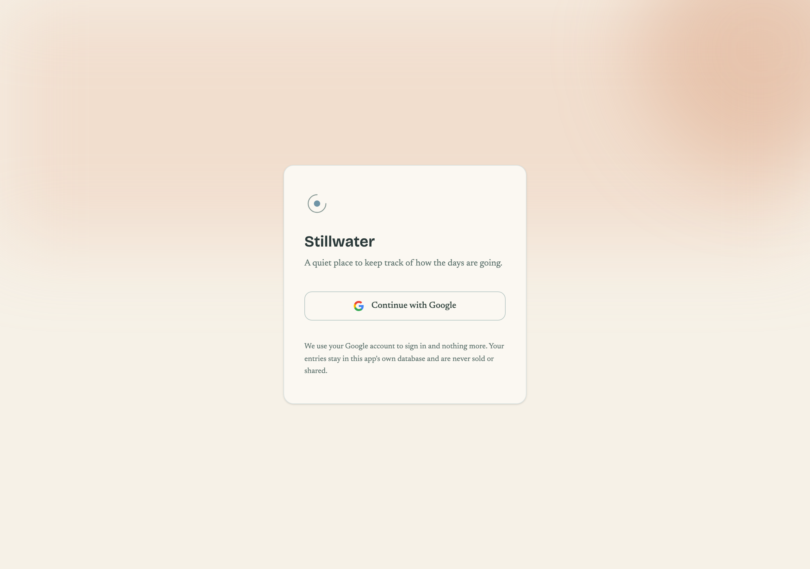
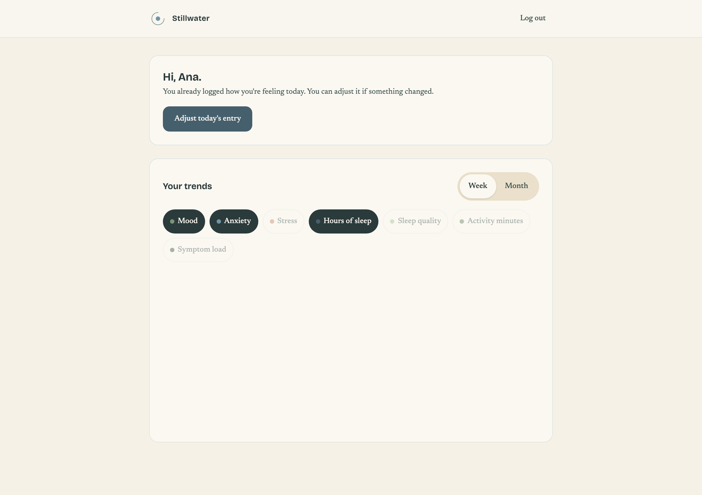
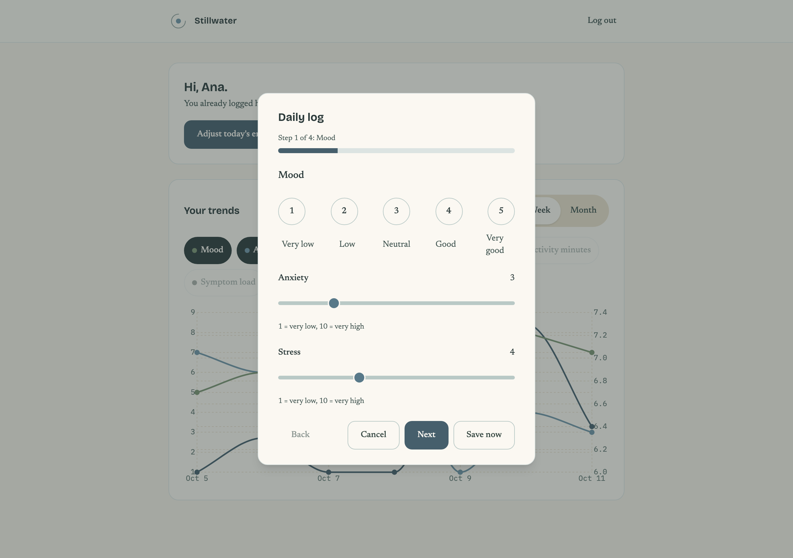

# Mental Health Tracker

Mental Health Tracker es una aplicación diseñada para que pacientes registren su estado de salud mental de forma diaria. A través de un flujo sencillo de registro, cada paciente puede anotar su ánimo, energía, sueño y otros factores relevantes en una captura rápida diaria, construyendo así un historial personal persistente y confiable.

Con base en esos registros, la aplicación genera tendencias semanales y mensuales que permiten al paciente (y a su profesional de la salud) visualizar la evolución de su estado a lo largo del tiempo. Las tendencias se presentan de forma clara e intuitiva, facilitando la detección de patrones y el acompañamiento en el proceso terapéutico.

## Capturas

| Inicio de sesión | Panel con tendencias | Registro diario |
| --- | --- | --- |
|  |  |  |

## Stack

| Tecnología   | Versión       | Uso                              |
| ------------ | ------------- | -------------------------------- |
| .NET         | 9             | Runtime del backend              |
| ASP.NET Core | 9             | API y servicios web              |
| EF Core      | 9             | ORM y acceso a datos             |
| PostgreSQL   | 16            | Base de datos                    |
| Vue 3        | 3             | Interfaz de usuario              |
| Vite         | —             | Build tooling del frontend       |
| Tailwind     | —             | Estilos y diseño                 |
| SignalR      | —             | Comunicación en tiempo real      |
| Docker       | —             | Contenedores y despliegue local  |

## Arranque con Docker

Para levantar el entorno de desarrollo completo:

```bash
cp .env.example .env
docker compose up --build
```

El stack levanta tres servicios con hot-reload (los cambios en el código se aplican sin reconstruir la imagen).

### Puertos expuestos

| Servicio  | Puerto            | Descripción                    |
| --------- | ----------------- | ------------------------------ |
| Frontend  | `5173`            | App Vue 3 + Vite (dev server)  |
| API       | `3000`            | Backend .NET (dotnet watch)    |
| Postgres  | `5432`            | Base de datos PostgreSQL 16    |

### Documentación de la API

Disponible en desarrollo en `http://localhost:3000/openapi/v1.json` (OpenAPI generado por ASP.NET Core).

## Producción con Docker

El archivo `docker-compose.prod.yml` levanta la pila de producción (Postgres + backend + frontend sobre nginx) usando las imágenes multi-stage de `backend/Dockerfile.prod` y `frontend/Dockerfile.prod`. Corre bajo su propio proyecto de Compose (`name: mht-prod`), de modo que contenedores, red, volúmenes e imágenes quedan aislados del stack de desarrollo: sin ese `name` ambos compartirían el volumen `postgres-data` y las etiquetas de las imágenes.

### Secretos

Los valores sensibles **nunca** van en el compose ni en un `.env`: se inyectan como Docker secrets montados en `/run/secrets/*` y el backend los lee con la variante `*_FILE`. Crea los cuatro archivos (están en `.gitignore`, no se versionan). El detalle de qué contiene cada uno y cómo generarlos está en [`secrets/README.md`](secrets/README.md):

```bash
umask 077
openssl rand -base64 32 | tr -d '\n' > secrets/postgres_password.txt
DB_PASS="$(cat secrets/postgres_password.txt)"
printf 'Host=postgres;Port=5432;Database=mentalhealthtracker;Username=postgres;Password=%s' "$DB_PASS" | tr -d '\n' > secrets/database_url.txt
openssl rand -base64 48 | tr -d '\n' > secrets/jwt_secret.txt
printf '%s' 'el-client-secret-de-google' > secrets/google_client_secret.txt
```

### Variables no sensibles

Copia la plantilla y ajusta los valores (usuario/nombre de base, `GOOGLE_CLIENT_ID`, URLs, nivel de log y puerto):

```bash
cp .env.production.example .env.production
```

### Levantar la pila

```bash
docker compose --env-file .env.production -f docker-compose.prod.yml up -d --build
```

El frontend queda disponible en `http://localhost:8080` (o el `HTTP_PORT` configurado). Al arrancar, el backend aplica las migraciones de EF Core y expone el healthcheck real (`SELECT 1` contra Postgres) en `/api/health`.

### Verificar que está sana

```bash
# Los tres servicios deben aparecer como "healthy".
docker compose --env-file .env.production -f docker-compose.prod.yml ps

# Healthcheck del backend a través del proxy del frontend.
curl http://localhost:8080/api/health   # -> {"status":"ok","uptime":...}
```

Ante un fallo, `docker compose --env-file .env.production -f docker-compose.prod.yml logs <servicio>` muestra la causa (p. ej. un secreto ausente hace que el backend falle la validación de configuración antes del healthcheck).

### Apagado ordenado

El backend maneja `SIGTERM`: deja de aceptar conexiones nuevas, cierra las conexiones de SignalR y el pool de Postgres, y fuerza la salida tras 10 segundos si algo se queda colgado. Por eso `docker compose ... stop` (o `down`) termina en pocos segundos.

### Bajar la pila

```bash
# Conserva el volumen de datos.
docker compose --env-file .env.production -f docker-compose.prod.yml down

# Elimina también el volumen de Postgres.
docker compose --env-file .env.production -f docker-compose.prod.yml down -v
```

## Variables de entorno

El backend se configura con el *configuration provider* de .NET: cada clave usa `:` como separador y, como variable de entorno, se escribe con `__` (doble guion bajo), de modo que `GoogleOAuth__ClientId` define `GoogleOAuth:ClientId`. Los **secretos** pueden darse en claro o por archivo con la variante `*_FILE`: `SecretFileConfigurationProvider` lee `JWT_SECRET_FILE`, `GOOGLE_CLIENT_SECRET_FILE` y `Database__ConnectionString_FILE` y los mapea a `Jwt:Secret`, `GoogleOAuth:ClientSecret` y `Database:ConnectionString`. Esa variante **solo** existe para esas tres claves del backend (más `POSTGRES_PASSWORD_FILE`, que la propia imagen de Postgres soporta): ninguna otra variable acepta `*_FILE`. Fíjate en la asimetría de nombres: dos usan el nombre corto (`JWT_SECRET_FILE`, `GOOGLE_CLIENT_SECRET_FILE`) y una el formato `__` (`Database__ConnectionString_FILE`); el equivalente nativo `Jwt__Secret_FILE` **no** funciona. Los secretos pueden darse también con el nombre nativo (`Jwt__Secret`, `GoogleOAuth__ClientSecret`), que el provider de .NET lee directamente.

Las **seis claves obligatorias del backend** (`Database:ConnectionString`, `Jwt:Secret`, `GoogleOAuth:ClientId`, `GoogleOAuth:ClientSecret`, `GoogleOAuth:RedirectUri`, `AppUrls:FrontendUrl`) se validan al arrancar con `ValidateOnStart`: si falta alguna, el proceso falla antes de atender la primera petición.

| Variable | Dónde se usa | Obligatoria | Acepta `*_FILE` | Ejemplo / valor por defecto |
| --- | --- | --- | --- | --- |
| `Database__ConnectionString` | Backend · `Database:ConnectionString` — EF Core, healthcheck (`SELECT 1`) y migraciones | Sí | Sí (`Database__ConnectionString_FILE`) | `Host=postgres;Port=5432;Database=mentalhealthtracker;Username=postgres;Password=…` |
| `JWT_SECRET` | Backend · `Jwt:Secret` — firma y verificación del JWT (≥ 16 caracteres) | Sí | Sí (`JWT_SECRET_FILE`) | valor aleatorio (`openssl rand -base64 48`) |
| `Jwt__ExpiresInDays` | Backend · `Jwt:ExpiresInDays` — caducidad de la cookie de sesión | No | No | `7` |
| `GoogleOAuth__ClientId` | Backend · `GoogleOAuth:ClientId` — flujo OAuth con Google | Sí | No | `xxxxx.apps.googleusercontent.com` |
| `GOOGLE_CLIENT_SECRET` | Backend · `GoogleOAuth:ClientSecret` — intercambio de tokens con Google | Sí | Sí (`GOOGLE_CLIENT_SECRET_FILE`) | secreto de Google Cloud Console |
| `GoogleOAuth__RedirectUri` | Backend · `GoogleOAuth:RedirectUri` — callback del flujo OAuth | Sí | No | `http://localhost:5173/auth/callback` |
| `AppUrls__FrontendUrl` | Backend · `AppUrls:FrontendUrl` — política CORS y redirecciones al frontend | Sí | No | `http://localhost:5173` |
| `LOG_LEVEL` | Backend · nivel mínimo de Serilog (`Verbose`…`Fatal`) | No | No | `Information` |
| `ASPNETCORE_ENVIRONMENT` | Backend · entorno del host (`Development`/`Testing`/`Production`) — habilita Swagger y `POST /api/auth/test-login` | No | No | `Development` (dev) · `Production` (prod) |
| `ASPNETCORE_URLS` | Backend · direcciones de escucha de Kestrel | No | No | `http://+:3000` (imagen) |
| `PORT` | — **no consumida** (la imagen fija `ASPNETCORE_URLS`; residuo de la plantilla) | No | No | — |
| `ConnectionStrings__Default` | — **no consumida** por la app (residuo de la plantilla, presente en `.env.example`) | No | No | — |
| `VITE_PROXY_TARGET` | Frontend · Vite dev server — destino del proxy `/api` y `/hub` | No | No | `http://localhost:3000` (host) · `http://backend:3000` (Compose) |
| `POSTGRES_USER` | Contenedor Postgres · usuario de la base de datos | No | No | `postgres` |
| `POSTGRES_PASSWORD` | Contenedor Postgres · password de la base de datos | No | Sí (`POSTGRES_PASSWORD_FILE`) | `postgres` (dev) · secreto (prod) |
| `POSTGRES_DB` | Contenedor Postgres · nombre de la base de datos | No | No | `mentalhealthtracker` |
| `POSTGRES_PORT` | — **no consumida** (el compose publica `5432` fijo) | No | No | — |
| `HTTP_PORT` | Compose de producción · puerto público del frontend en el host | No | No | `8080` |
| `GOOGLE_CLIENT_ID` | Compose de producción · se inyecta al backend como `GoogleOAuth__ClientId` | Sí (prod) | No | `xxxxx.apps.googleusercontent.com` |
| `GOOGLE_REDIRECT_URI` | Compose de producción · se inyecta como `GoogleOAuth__RedirectUri` | No | No | `http://localhost:8080/auth/callback` |
| `FRONTEND_URL` | Compose de producción · se inyecta como `AppUrls__FrontendUrl` | No | No | `http://localhost:8080` |

Las plantillas `.env.example` (desarrollo/E2E) y `.env.production.example` (producción) traen estos valores prellenados; el detalle de los secretos y cómo generarlos está en [`secrets/README.md`](secrets/README.md).

## Comandos útiles

### Backend

Los comandos se ejecutan desde la raíz del repositorio. `dotnet ef` requiere la herramienta instalada (`dotnet tool install --global dotnet-ef`); el manifiesto del repo solo fija `reportgenerator`.

| Comando | Qué hace |
| --- | --- |
| `dotnet run --project backend/MentalHealthTracker.Api` | Arranca la API en local (requiere Postgres en `Database:ConnectionString`). |
| `dotnet run --project backend/MentalHealthTracker.Api --no-launch-profile -- --seed` | Aplica las migraciones y carga el usuario demo con 60 días de registros. Equivale a `make seed`. |
| `dotnet ef migrations add <Nombre> --project backend/MentalHealthTracker.Infrastructure --startup-project backend/MentalHealthTracker.Api` | Crea una migración nueva en `Infrastructure/Persistence/Migrations`. |
| `dotnet ef database update --project backend/MentalHealthTracker.Infrastructure --startup-project backend/MentalHealthTracker.Api` | Aplica las migraciones pendientes. Equivale a `make migrate`. |
| `dotnet test backend/tests/MentalHealthTracker.UnitTests/MentalHealthTracker.UnitTests.csproj` | Ejecuta las pruebas unitarias (sin base de datos ni HTTP). |
| `dotnet test backend/tests/MentalHealthTracker.IntegrationTests/MentalHealthTracker.IntegrationTests.csproj` | Ejecuta las pruebas de integración (necesita `postgres-test` en el puerto `5433`). |
| `make test` | Levanta `postgres-test`, corre las dos capas con cobertura y falla si queda por debajo del 70 %. |

### Frontend

Los comandos se ejecutan dentro de `frontend/`.

| Comando | Qué hace |
| --- | --- |
| `npm run dev` | Levanta el dev server de Vite en `http://localhost:5173` con HMR. |
| `npm run build` | Comprueba los tipos (`vue-tsc -b`) y genera el bundle de producción. |
| `npm run test:unit` | Ejecuta las pruebas unitarias con Vitest (una pasada, sin navegador). |
| `npm run test:unit:coverage` | Igual que la anterior, con informe de cobertura. |
| `npm run lint` | Verifica el código con ESLint (`npm run lint:fix` para aplicar los arreglos). |
| `npm run format` | Comprueba el formato con Prettier (`npm run format:fix` para reescribirlo). |

## Testing

### Capas de pruebas

| Capa                  | Qué cubre                                                                                                       | Cómo ejecutarla                                                                                                                              | Estado              |
| --------------------- | --------------------------------------------------------------------------------------------------------------- | -------------------------------------------------------------------------------------------------------------------------------------------- | ------------------- |
| Unitarias (backend)   | Lógica de dominio, validación y casos límite de la API, aislada de la base de datos y de HTTP.                  | `dotnet test backend/tests/MentalHealthTracker.UnitTests/MentalHealthTracker.UnitTests.csproj`                                                | Configurado (52)    |
| Integración (backend) | Endpoints HTTP, autenticación OAuth, repositorios y SignalR contra una PostgreSQL 16 real (Docker, puerto `5433`). | `make test` — levanta `postgres-test`, ejecuta las dos capas del backend y verifica el umbral de cobertura                                 | Configurado (19)    |
| Unitarias (frontend)  | Lógica de componentes y *composables* de Vue, sin navegador.                                                    | `cd frontend && npm run test:unit`                                                                                                            | Runner listo (22)  |
| E2E (Playwright)      | Flujos completos de usuario navegador → frontend → API → PostgreSQL.                                            | Requiere la pila E2E arriba; ver [Pruebas E2E](#pruebas-e2e-playwright)                                                                       | Configurado (5)     |

**Notas**

- `make test` fusiona la cobertura de las dos capas del backend (Coverlet + ReportGenerator) y **falla si la cobertura de líneas baja del 70 %**; la medición actual es de 75 %.
- `npm run test:unit` del frontend usa Vitest y corre sin navegador. El entorno global es `node`, porque el cliente de la API y el store no tocan el DOM; los tests de componente que sí lo necesitan montan la vista con Vue Test Utils sobre `jsdom` mediante un docblock `@vitest-environment`, de modo que solo ese fichero paga el coste de levantar un DOM.
- La suite de frontend cubre hoy el cliente de la API, el store de autenticación y la vista de login. Los tests de componente montan la vista real con un router de memoria y un Pinia reales, y solo sustituyen `fetch`: la lógica que interesa es la que une el `query` de la ruta, el store y el router, así que falsificar cualquiera de los dos dejaría el cableado real fuera del alcance del test.
- La suite E2E vive en `e2e/`; `make test-e2e` ejecuta la suite completa y requiere la pila E2E levantada. Ver [Pruebas E2E](#pruebas-e2e-playwright) para levantar la pila, instalar los navegadores de Playwright y volver al entorno normal.

### Pruebas E2E (Playwright)

La suite E2E vive en `e2e/` (Playwright + TypeScript, solo Chromium) y recorre flujos completos de usuario contra el stack real: navegador → frontend → API → PostgreSQL. El `baseURL` es `http://localhost:5173`, así que primero hay que tener una pila viva.

1. **Levantar la pila E2E.** Primero crea un `.env` desde `.env.example` con valores desechables: el override `docker-compose.e2e.yml` lo inyecta al backend dentro de Docker. Se arranca con el override, que fija `ASPNETCORE_ENVIRONMENT=Testing` en el backend y habilita `POST /api/auth/test-login`, el endpoint que las pruebas usan para autenticarse sin pasar por el consentimiento de Google:

   ```bash
   docker compose -f docker-compose.yml -f docker-compose.e2e.yml up -d --build
   ```

2. **Instalar los navegadores de Playwright** (solo la primera vez):

   ```bash
   cd e2e && npm install && npx playwright install chromium
   ```

3. **Ejecutar la suite**, ya sea completa o solo los tests etiquetados `@smoke`:

   ```bash
   cd e2e && npm test            # suite completa (smoke + flujos críticos)
   cd e2e && npm run test:smoke  # solo los tests con la etiqueta @smoke
   ```

   Tras la ejecución, el reporte HTML queda en `e2e/playwright-report/`; se abre con `npm run report`.

4. **Volver a la pila normal.** El override solo aplica al entorno de pruebas, así que hay que bajar la pila E2E y levantarla sin él (equivalente a `make up`) para que el backend deje de correr con `ASPNETCORE_ENVIRONMENT=Testing` y `POST /api/auth/test-login` deje de existir:

   ```bash
   docker compose down
   docker compose up -d --build
   ```

## CI (GitHub Actions) y protección de ramas

El workflow `.github/workflows/ci.yml` corre en cada `pull_request` y en `push` a `main`, y ejecuta estos jobs:

| Job                    | Qué hace                                                                                                     |
| ---------------------- | ------------------------------------------------------------------------------------------------------------ |
| Backend (.NET)         | Restaura, compila y ejecuta los tests unitarios del backend.                                                 |
| Frontend (Node)        | Instala dependencias, ejecuta los tests unitarios (Vitest) y compila el bundle.                              |
| Backend tests          | Compila la solución y corre unitarias + integración (Postgres 16 como servicio) con cobertura ≥ 70 %.        |
| Frontend tests         | Ejecuta los tests unitarios de Vitest con cobertura.                                                         |
| Lint                   | `dotnet format --verify-no-changes`, ESLint y Prettier.                                                      |
| Security audit         | `dotnet list package --vulnerable --include-transitive` y `npm audit --audit-level=high`.                    |
| E2E (Playwright)       | Levanta la pila E2E (override con `ASPNETCORE_ENVIRONMENT=Testing`) y ejecuta la suite completa.             |
| Build prod images      | Construye las imágenes de producción y verifica que el backend corre como no-root y reintenta la conexión a la BD en vez de crashear. |

**Protección de `main`:** la rama exige que **todos** los checks del CI pasen antes de permitir el merge, y la regla aplica también a los administradores del repositorio. Están bloqueados además los force-pushes y la eliminación de la rama: los cambios entran únicamente vía `pull_request`.